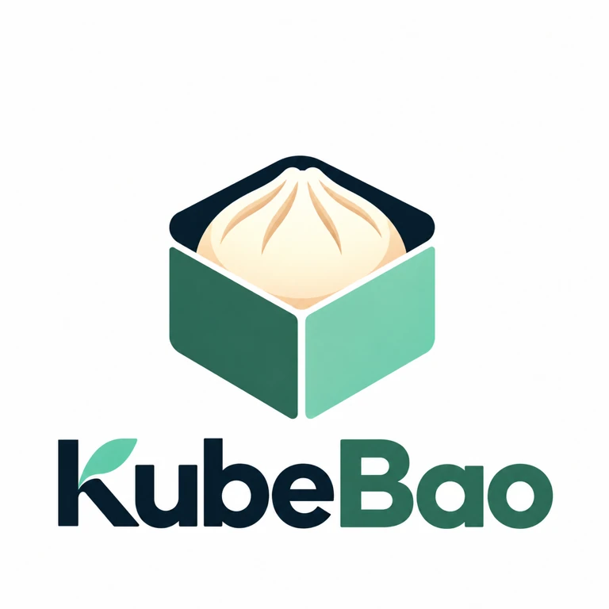
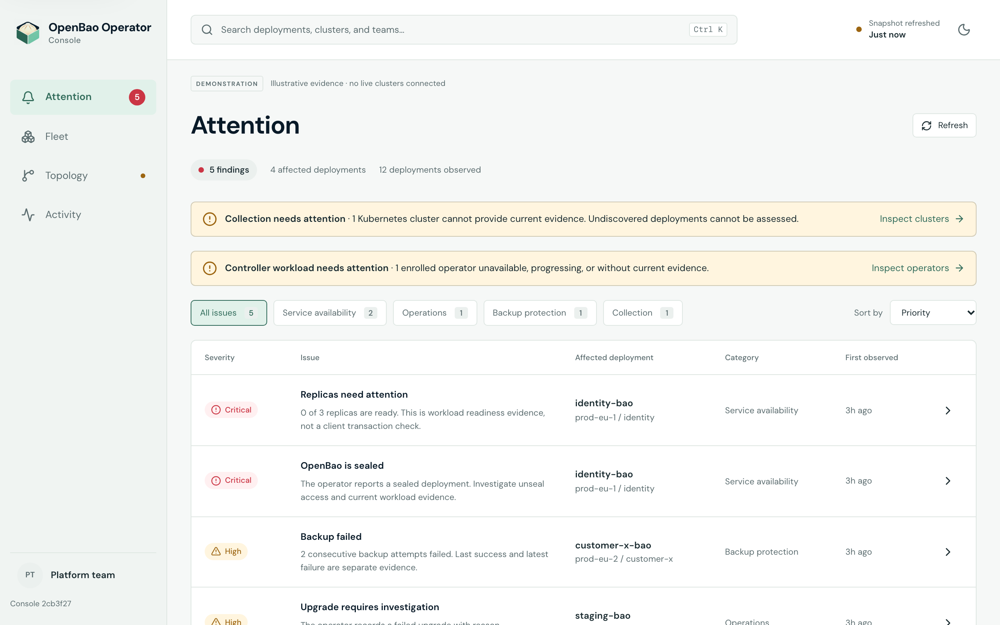
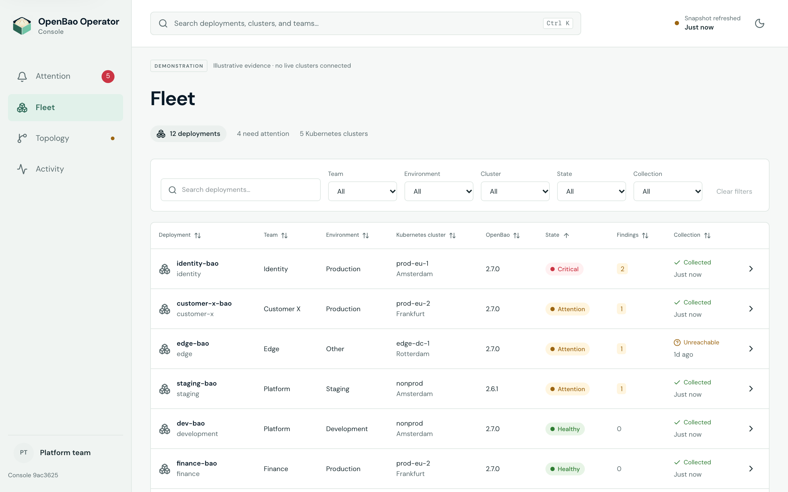
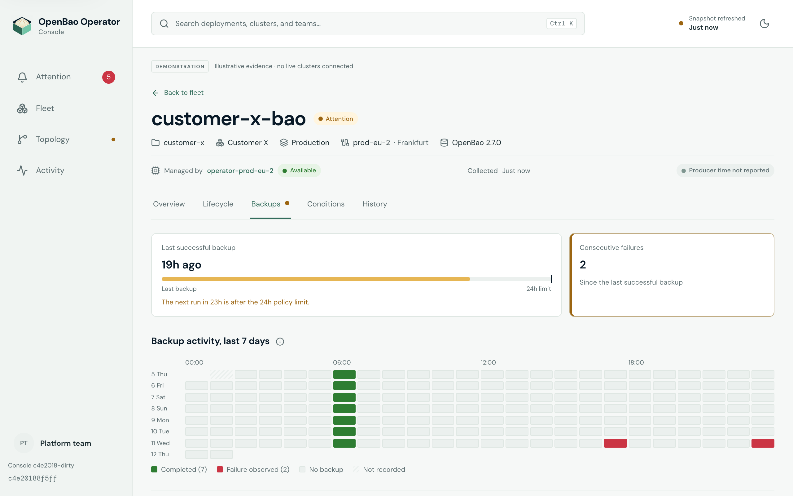
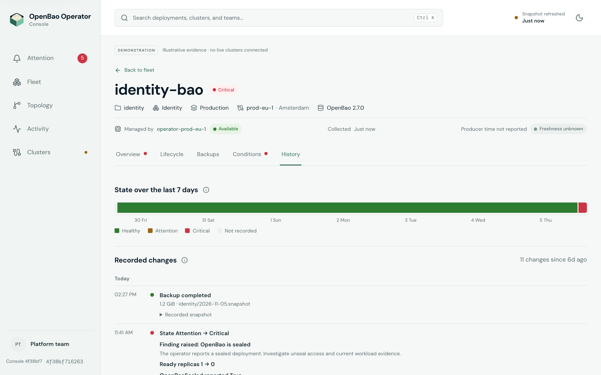
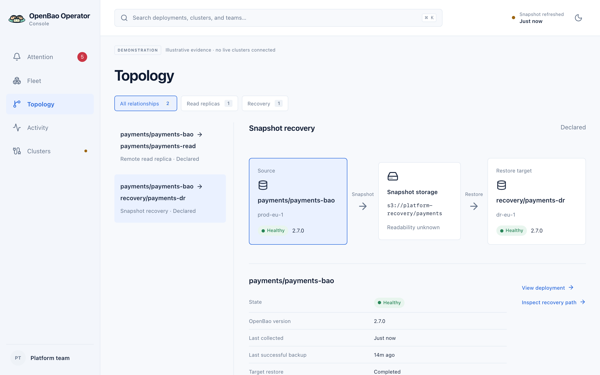
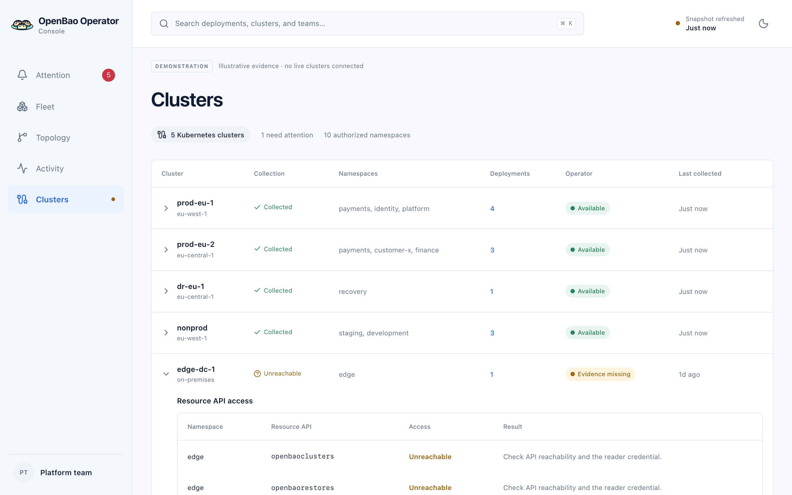
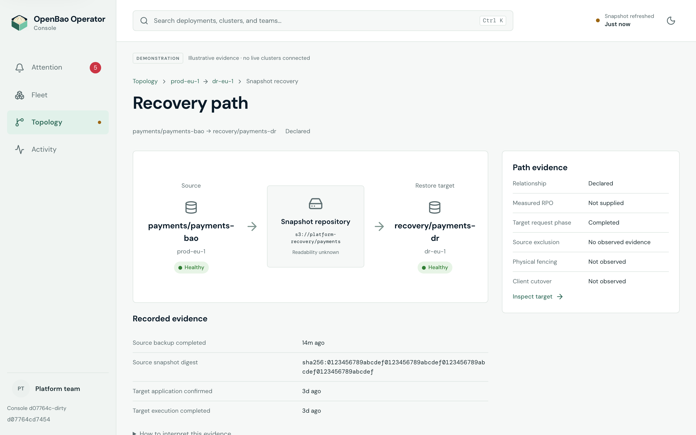
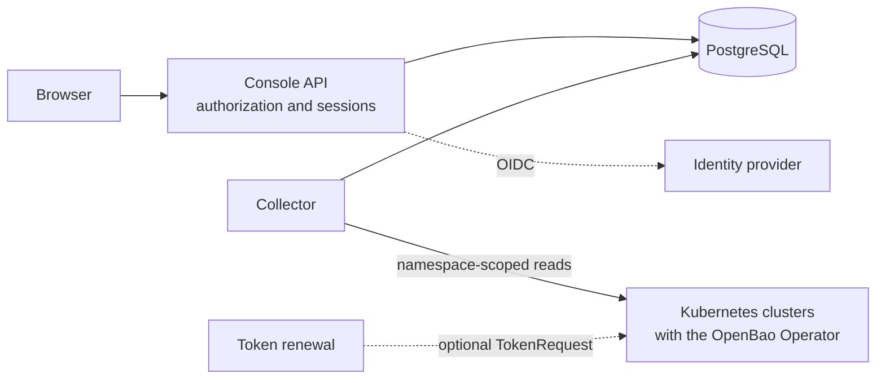

<div align="center">

<picture>
  <source media="(prefers-color-scheme: dark)" srcset="web/public/brand/kubebao-logo-dark.webp">
  
</picture>

# OpenBao Operator Console

**A read-only fleet console for the [OpenBao Operator](https://github.com/kubebao/openbao-operator).**

[](https://github.com/kubebao/openbao-operator-console/actions/workflows/check.yml)
[](https://scorecard.dev/viewer/?uri=github.com/kubebao/openbao-operator-console)
[](LICENSE)

[Quick start](#quick-start) • [Install](docs/installation.md) • [Documentation](#documentation) • [Contributing](CONTRIBUTING.md)

</div>

> [!WARNING]
> **Early development.** No release has been published yet. Until the first release publishes a signed image and chart
> to GHCR, build the image from source and install the chart from a checkout. Some evidence (restore tests, native
> recovery, remote replicas) depends on operator features that are still in development. Configuration, Helm values,
> and the database schema may change before 1.0.



The console is a companion to the [OpenBao Operator](https://github.com/kubebao/openbao-operator). It gives platform
teams one place to see which OpenBao deployments need attention across many Kubernetes clusters, and why. It reads the
operator's public Kubernetes resources, keeps a history of what it observed, and explains the evidence behind each
finding.

The workload reader does not create or modify resources, read Secrets, exec into Pods, or send requests to OpenBao.
Optional credential renewal uses TokenRequest only for the enrolled ServiceAccount. Lifecycle operations stay with the
operator and your runbooks.

OpenBao Operator Console is maintained by [KubeBao](https://kubebao.org), an independent open-source project. It is not
an official OpenBao project.

## Features

- **Attention first.** Findings for unavailable replicas, sealed deployments, failed or overdue backups, failed restore
  tests, failed upgrades, recovery problems, and collection gaps, ordered by severity.
- **Evidence you can trace.** Each finding links to the tab and the exact evidence rows that produced it. Collection
  time, producer time, and state transitions stay separate, and missing evidence is shown as unknown, never as healthy.
- **Deployment health at a glance.** Availability, backups, restore tests, and lifecycle on one overview; backup age
  against policy; interpreted operator conditions; and upgrade and recovery progress.
- **Change history.** Seven days of recorded state and a plain-language timeline of what changed, such as findings
  raised and resolved, replica counts, versions, conditions, and backups. Load older pages of history and activity;
  charts distinguish unloaded records from unrecorded time.
- **Fleet inventory.** Search, filters you can share as URLs, and severity sorting across clusters, teams, and
  environments.
- **Topology and recovery paths.** A map of clusters, their enrolled operators, and the deployments each operator
  manages, joined by declared replication and snapshot recovery relationships bound to resource UIDs. Zoom into a
  cluster for its operators and API access, or into a relationship for the evidence available for that path.
- **Multi-cluster collection.** Namespace-scoped readers per cluster, named operator Deployment observation, and opt-in
  automatic ServiceAccount token renewal for remote clusters.
- **Guided onboarding.** Generated least-privilege reader RBAC, connection checks, and deployment previews before a
  cluster is saved.
- **Scoped access.** OpenID Connect login with PKCE, or local accounts with a password and an authenticator app;
  per-user and per-group namespace scopes; and administrator-only settings with a change history.
- **Built for operators.** Light and dark themes, keyboard search (<kbd>⌘</kbd>/<kbd>Ctrl</kbd> + <kbd>K</kbd>),
  responsive layout, and reduced-motion support.

## Screenshots

| Fleet inventory | Deployment overview |
| --- | --- |
|  |  |
| **Backup health** | **Change history** |
|  |  |
| **Topology map** | **Cluster view** |
|  |  |
| **Recovery path** | |
|  | |

A [dark theme](docs/images/attention-dark.png) is included. The screenshots show the built-in demonstration data;
regenerate them with `make screenshots`.

## Quick start

Try the console with demonstration data. No Kubernetes cluster, database, or identity provider is required.

```sh
docker run --rm -p 127.0.0.1:8090:8090 ghcr.io/kubebao/openbao-operator-console:<version> \
  --mode=demo --listen=0.0.0.0:8090 --demo-allow-external
```

Open <http://127.0.0.1:8090>. Demo mode needs no login and labels every page as demonstration data, so publish its port
on `127.0.0.1` only.

> [!NOTE]
> Before the first release, build the image from a checkout with `make image` and run `openbao-operator-console:local`
> instead. Or build the binary (Go 1.27, Node.js 26, pnpm 11) and run it directly:
>
> ```sh
> git clone https://github.com/kubebao/openbao-operator-console.git
> cd openbao-operator-console
> make install build
> ./bin/console --mode=demo
> ```

To run the console against real clusters, follow the [installation guide](docs/installation.md): PostgreSQL, one
Secret, the Helm chart, and a guided first sign-in.

## How it works



One Go binary serves the web application and API, runs the collectors, and stores projected observations, findings, and
encrypted configuration in PostgreSQL. See [architecture](docs/architecture.md) and the
[security model](docs/security.md).

## Requirements

| Component | Requirement |
| --- | --- |
| OpenBao Operator | Clusters managed by the [OpenBao Operator](https://github.com/kubebao/openbao-operator) (`openbao.org/v1alpha1` APIs) |
| Kubernetes | 1.33 or later for the Helm chart; a namespace-scoped reader per cluster; the hosting cluster can use the console's ServiceAccount |
| PostgreSQL | An external database; CI tests PostgreSQL 18 |
| Identity provider | Recommended: an OpenID Connect provider with authorization code flow and PKCE, such as Keycloak. A local administrator with an authenticator app works without one |
| Network | HTTPS in front of the console, through an ingress, a gateway, or direct TLS |

A compatibility matrix with operator releases will be published with the first console release.

## Documentation

| Guide | Contents |
| --- | --- |
| [Installation](docs/installation.md) | Helm installation, runtime Secret, PostgreSQL, encryption key, and HTTPS |
| [First administrator setup](docs/bootstrap.md) | Protected browser setup or automated identity bootstrap |
| [Connect a Kubernetes cluster](docs/cluster-onboarding.md) | Guided onboarding, reader RBAC, verification, and credential replacement |
| [Credential renewal](docs/credential-renewal.md) | Automatic ServiceAccount token renewal for remote clusters |
| [Administration](docs/administration.md) | Access rules, local accounts, relationships, identity provider changes, recovery, and upgrades |
| [Upgrade and roll back](docs/upgrading.md) | Backups, Helm upgrades, and rollback limits across schema versions |
| [Troubleshooting](docs/troubleshooting.md) | Startup failures, health checks, sign-in problems, logs, and collection states |
| [Keycloak](docs/keycloak.md) | Configure Keycloak as the OpenID Connect provider |
| [Enrollment files and CLI](docs/connect-clusters.md) | First-start enrollment YAML, `--print-rbac`, and `--check` diagnostics |
| [Command-line and environment](docs/configuration.md) | Flags, environment variables, and running without Kubernetes |
| [Attention rules](docs/attention-rules.md) | What each finding means and what it does not prove |
| [Security model](docs/security.md) | Permissions, stored data, sessions, and encryption |
| [Architecture](docs/architecture.md) | Components, evidence handling, and design boundaries |
| [Development](docs/development.md) | Local development, tests, CI, and integration environments |
| [Releases](docs/releasing.md) | Release flow and how to verify signed images, charts, and SBOMs |

## Contributing

Contributions are welcome. Read [CONTRIBUTING.md](CONTRIBUTING.md) for the development workflow and conventions.
Report security issues privately as described in [SECURITY.md](SECURITY.md).

## License

Licensed under the [Apache License 2.0](LICENSE). Third-party notices are in
[THIRD_PARTY_LICENSES](THIRD_PARTY_LICENSES).

The KubeBao name and logo identify the KubeBao project. The Apache License 2.0 does not grant permission to use them, as
stated in section 6 of the license.
