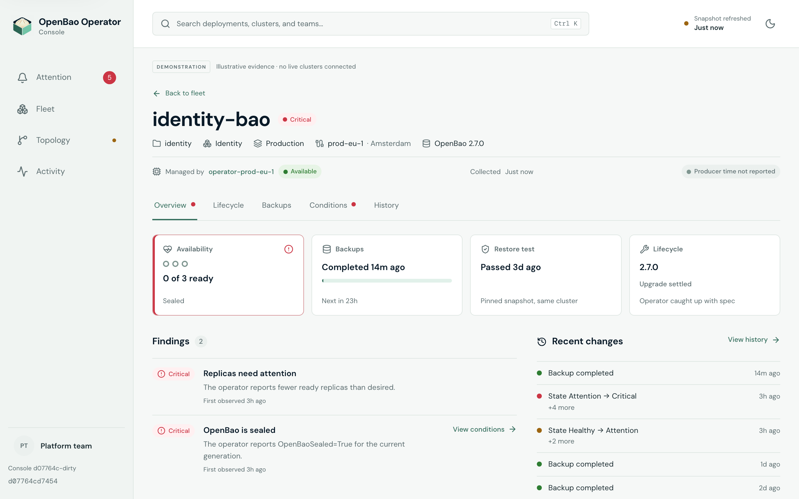

<div align="center">

<picture>
  <source media="(prefers-color-scheme: dark)" srcset="web/public/brand/kubebao-logo-dark.webp">
  
</picture>

# OpenBao Operator Console

**A read-only fleet console for the [OpenBao Operator](https://github.com/kubebao/openbao-operator).**

[](https://github.com/kubebao/openbao-operator-console/actions/workflows/check.yml)
[](https://scorecard.dev/viewer/?uri=github.com/kubebao/openbao-operator-console)
[](LICENSE)

[Quick start](#quick-start) • [Install](docs/installation.md) • [Documentation](#documentation) • [Contributing](CONTRIBUTING.md)

</div>

> [!WARNING]
> **Early development.** No stable release has been published yet, and configuration, Helm values, and the database schema
> may change before 1.0.


The console shows platform teams which OpenBao deployments need attention across their Kubernetes clusters, and why. It
reads the OpenBao Operator's resources, keeps a short history of what it observed, and shows the evidence behind each
finding.

It only observes. It does not change resources, read Secrets, exec into Pods, or send requests to OpenBao. Lifecycle
operations stay with the operator and your runbooks.

OpenBao Operator Console is maintained by [KubeBao](https://kubebao.org), an independent open-source project. It is not
an official OpenBao project.

## Features

- **Attention first.** Unavailable or sealed deployments, failed or overdue backups, failed upgrades, and collection
  gaps, ordered by severity.
- **Traceable evidence.** Each finding links to the evidence that produced it. Missing evidence is shown as unknown,
  never as healthy.
- **History.** A week of recorded state and a timeline of what changed.
- **Many clusters, least privilege.** Read-only, namespace-scoped access per cluster, with guided onboarding that
  generates the RBAC for you.
- **Your sign-in.** OpenID Connect single sign-on, or local accounts with an authenticator app, with per-user and
  per-group namespace access.

Restore tests, native recovery, and replication evidence depend on OpenBao Operator features that are still in
development. Until they ship, the console shows that evidence as unknown.

| Deployment overview | Topology |
| --- | --- |
|  |  |

## Quick start

Build and run it with demonstration data. Use the [development toolchain](CONTRIBUTING.md#set-up).
No cluster, database, or identity provider is needed:

```sh
git clone https://github.com/kubebao/openbao-operator-console.git
cd openbao-operator-console
make install build
./bin/console --mode=demo
```

Open <http://127.0.0.1:8090>. Demo mode has no login and binds to loopback by default.
This is a source-first opening. Release images, charts, and downloads are not published yet.
The [publication procedure](docs/source-publication.md) keeps release and edge publishing disabled until separately approved.

To try it against a real OpenBao Operator, [`make evaluation`](docs/evaluation.md) creates a disposable kind cluster
with the operator, an OpenBao cluster, and the console. For your own clusters, follow the
[installation guide](docs/installation.md).

## Requirements

| Component | Requirement |
| --- | --- |
| OpenBao Operator | Clusters managed by the [OpenBao Operator](https://github.com/kubebao/openbao-operator) |
| Kubernetes | 1.33 or later |
| State | SQLite on a durable local or block volume by default; optional PostgreSQL 18 |
| Sign-in | An OpenID Connect provider is recommended; local accounts work without one |
| Network | HTTPS through an ingress, a Gateway, or the console itself |

## Documentation

**Get started:** [evaluate on a local cluster](docs/evaluation.md) · [install](docs/installation.md) ·
[first administrator](docs/bootstrap.md) · [connect a cluster](docs/cluster-onboarding.md)

**Operate:** [administration](docs/administration.md) · [upgrade and roll back](docs/upgrading.md) ·
[troubleshooting](docs/troubleshooting.md) · [credential renewal](docs/credential-renewal.md) ·
[Keycloak](docs/keycloak.md)

**Reference:** [attention rules](docs/attention-rules.md) · [security model](docs/security.md) ·
[architecture](docs/architecture.md) · [command line and environment](docs/configuration.md) ·
[enrollment files](docs/connect-clusters.md) · [releases](docs/releasing.md) · [development](docs/development.md)

## Contributing

Contributions are welcome. Read [CONTRIBUTING.md](CONTRIBUTING.md) for the workflow and conventions. Report security
issues privately as described in [SECURITY.md](SECURITY.md).

## License

Licensed under the [Apache License 2.0](LICENSE). Third-party notices are in
[THIRD_PARTY_LICENSES](THIRD_PARTY_LICENSES).

The KubeBao name and logo identify the KubeBao project. The Apache License 2.0 does not grant permission to use them, as
stated in section 6 of the license.
