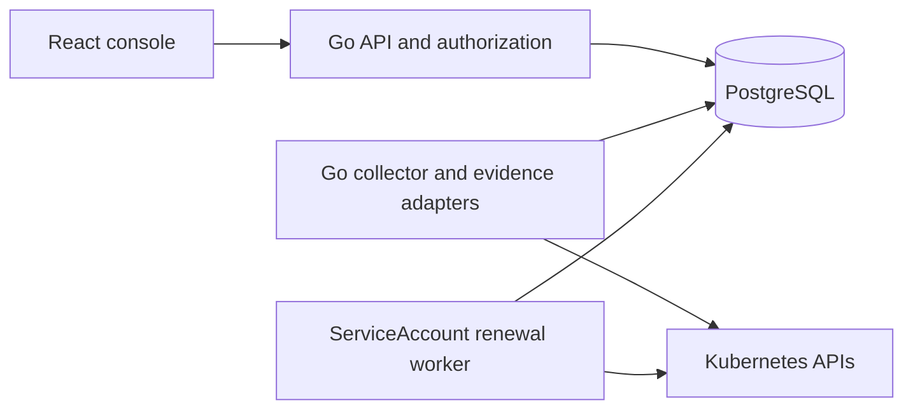

# Console architecture

## Product boundary

The console helps platform teams find issues across an OpenBao fleet. It observes public Kubernetes resources
published by the [OpenBao Operator](https://github.com/dc-tec/openbao-operator) and retains operational evidence. It
does not run lifecycle operations, manage secrets, or contact OpenBao.

Some operator APIs that the console reads are still in development, such as restore tests, snapshot restores, native
recovery, and remote replica observations. The console reads only fields that the installed schema supplies; missing
fields remain unknown. The `OpenBaoBackup` catalog is out of scope.

## Interface principles

- **Attention first.** The initial workspace lists findings. Fleet provides inventory, deployment pages explain
  evidence, Topology shows declared replication and recovery relationships, and Activity lists observed changes.
- **Readable density.** Quiet blue accents, fine dividers, and generous spacing keep dense operational evidence legible.
- **Traceable evidence.** A finding points to the tab and rows that produced it. Unknown evidence is labeled unknown.
- **Calm interaction.** Fast filter transitions and restrained motion support investigation. Reduced motion is
  respected, and light and dark themes share semantic color tokens.

## Runtime

One Go executable serves the compiled React application and a versioned JSON API. It runs scoped Kubernetes
collectors. PostgreSQL stores projected observations, findings, encrypted configuration, and the configuration change log. A fixture mode runs on loopback for local UI work.

Go owns interpretation, authorization, and persistence. React owns presentation and view filters. OpenAPI generates
both Go DTOs and TypeScript types. Kubernetes unstructured objects remain inside the collector package.

Resource identity includes enrollment ID, namespace, name, and UID. Relationships are administrator-defined and
bound to authorized resource identities. An endpoint match alone does not establish a relationship.

## Evidence

Store approved projections only. A successful collection does not prove a fresh controller observation. Condition
transition times are not reconciliation heartbeats. A backup completion time is not measured RPO. A restore-test pass
does not establish client login, secret reads, or a cross-cluster recovery drill.

Retain last-known deployments when collection fails. Record collection state separately from workload state. Record
first-seen time by resource identity and rule identity, and resolve findings only after a successful relevant observation.

## Deployment

Use one application image and an external PostgreSQL service in production. An evaluation Compose file can supply a
dedicated local database. Database failure affects the console only. OpenBao and operator recovery remain independent.

Kubernetes credentials are encrypted with AES-256-GCM before database storage. The encryption key stays outside PostgreSQL.
The settings service owns versioned configuration and serializes configuration commits with collection writes.
Reader credentials have independent encrypted records and revisions. A separate worker issues named TokenRequests,
validates the candidate through scoped collection, and commits it before activating it. Enrollment and credential revision
checks reject delayed replacements. A reader generation check rejects collection results from a superseded credential.
Background renewals preserve the editable configuration revision and its change log.
Kubernetes credentials stay in the backend. The reader lists OpenBao resources in enrolled namespaces and gets only named controller Deployments.
Live serving requires authentication and declared user scopes. Fixture mode is explicitly local and unauthenticated.

An empty database can enter protected browser setup using a deployment-provided setup token. Until a signed OIDC login
claims the first administrator, fleet APIs remain unavailable. Initialization commits encrypted configuration with
revision zero compare-and-swap. An initialized database never reopens setup. Automated identity seeding remains available.

Cluster onboarding generates scoped reader instructions before requesting credentials. Verification returns approved
deployment projections without persisting observations. Optional API absence or forbidden access remains visible in
capability results; authentication and transport failures prevent successful collection.

## Current limits

- One serving replica. Sessions are process-local and collectors are not coordinated across replicas.
- No lifecycle actions, outbound agents, backup catalog browsing, or backup repository read verification.
- No external fencing evidence or drill report ingestion.
- Remote readers whose token expires before renewal require manual reconnection.
- No key rotation tooling or separate database migration role yet.
