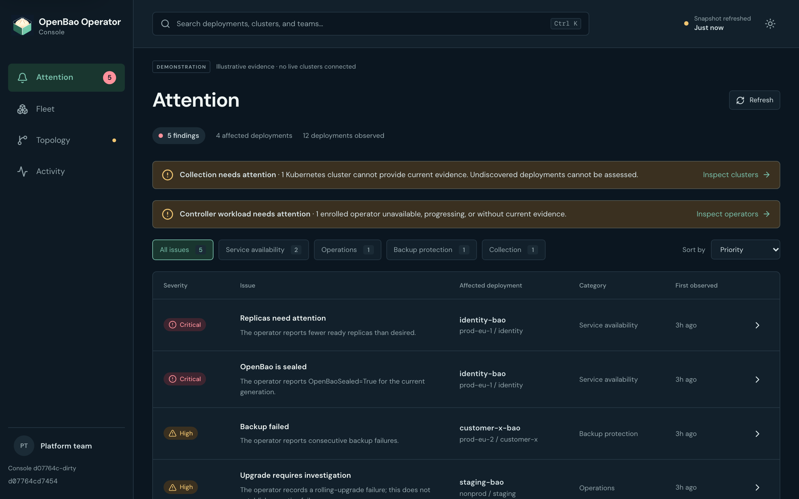
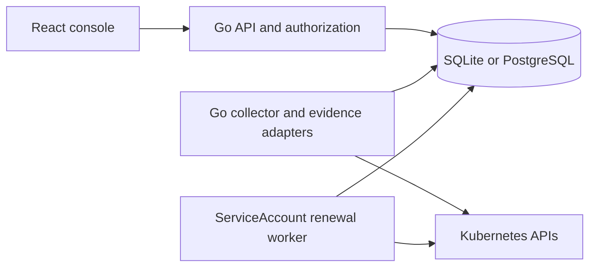

# Console architecture

## Product boundary

The console helps platform teams find issues across an OpenBao fleet. It observes public Kubernetes resources published
by the [OpenBao Operator](https://github.com/kubebao/openbao-operator) and retains operational evidence. It does not run
lifecycle operations, manage secrets, or contact OpenBao.

Some operator APIs that the console reads are still in development, such as restore tests, snapshot restores, native
recovery, and remote replica observations. The console reads only fields that the installed schema supplies; missing
fields remain unknown. The `OpenBaoBackup` catalog is out of scope.

The collector and reader RBAC target the operator's `openbao.org/v1alpha1` API group.

## Interface principles

- **Attention first.** The initial workspace lists findings. Fleet provides inventory, deployment pages explain
  evidence, Topology maps clusters, enrolled operators, and their deployments with declared replication and
  recovery relationships, and Activity lists observed changes.
- **Zoom by level.** Topology opens on the fleet map. A cluster view shows its operators, deployments, outgoing
  relationships, and API access. A relationship view shows the evidence its kind depends on. Each level has its own
  URL.
- **Readable density.** Quiet blue accents, fine dividers, and generous spacing keep dense operational evidence legible.
- **Traceable evidence.** A finding points to the tab and rows that produced it. Unknown evidence is labeled unknown.
- **Calm interaction.** Fast filter transitions and restrained motion support investigation. Reduced motion is
  respected, and light and dark themes share semantic color tokens.

## Runtime

One Go executable serves the compiled React application and a versioned JSON API. It runs scoped Kubernetes collectors.
SQLite by default, or PostgreSQL when configured, stores projected observations, findings, encrypted configuration, and the configuration change log. A fixture
mode serves demonstration data without login for evaluation and local UI work.

Go owns interpretation, authorization, and persistence. React owns presentation and view filters. OpenAPI generates both
Go DTOs and TypeScript types. Kubernetes unstructured objects remain inside the collector package. The collector,
evidence rules, and store share the `fleet` domain model; only the HTTP layer maps it to the generated API types.

Resource identity includes enrollment ID, namespace, name, and UID. Relationships are administrator-defined and bound to
authorized resource identities. An endpoint match alone does not establish a relationship.

## API contract

`api/openapi.yaml` lists every status that each operation returns. Failures use RFC 9457 problem details with the
media type `application/problem+json`. The `type` is `about:blank`, the `title` is the HTTP status phrase, the `detail`
is safe to show to the requester, and `code` is one of a fixed set of machine-readable reasons. Clients branch on
`status` and `code`, never on `detail`. A Go test checks that the `code` enum lists exactly the codes the handlers
emit.

The contract declares the session cookie as its global security requirement. Operations that run before sign-in, the
setup endpoints, declare their own requirements.

`GET /api/v1/snapshot` includes the running console's version and source revision in `build`. The sidebar displays
these values. Snapshot refresh does not read activity; an activity read failure does not block fleet evidence.

`GET /api/v1/activity` and `GET /api/v1/deployments/{id}/history` return the newest records first. Both accept `limit`
(1–500, default 100) and an opaque `cursor` from the previous page's `nextCursor`. A null `nextCursor` marks the last
page. A cursor belongs to one list; history cursors also bind the deployment and the unchanged `since` query value.
Each request resolves current access. Activity applies namespace scopes in SQL before the page limit, and history
authorizes the deployment before reading its observations.

History accepts an RFC 3339 `since` timestamp. Its first page also returns the newest observation before that window
as `baseline`, when one exists. The UI loads 100 records at a time and offers controls to load older records. Until all
pages in the window are loaded, it marks earlier time as **Not loaded** and does not connect the baseline across that
gap. A failed page read keeps the loaded records visible.

## Evidence

Store approved projections only. A successful collection does not prove a fresh controller observation. Condition
transition times are not reconciliation heartbeats. A backup completion time is not measured RPO. A restore-test pass
does not establish client login, secret reads, or a cross-cluster recovery drill.

Retain last-known deployments when collection fails. Record collection state separately from workload state. Record
first-seen time by resource identity and rule identity, and resolve findings only after a successful relevant
observation.

Activity records one structured event per transition: a health change, a collection change, or a finding that was
raised, resolved, or changed severity. Events carry a bounded `kind` and typed fields, never prose; the UI renders the
text. A finding whose detail alone changed, such as a failure counter, appears in history but not in activity.

The storage adapter identifies older events without structured fields as `legacy`. It preserves their resource identity
and database timestamp, leaves change details unknown, and does not return their old prose through the API.

The API keeps four times apart. `evidence.collectedAt` is the console's last successful read of a resource.
`producerObservedAt` is when the operator last reported it. Condition `lastTransitionAt` is when the operator saw a
state transition, and history and activity `recordedAt` is the collection attempt that first observed a change. A
snapshot's `generatedAt` is only when the console read its database; the UI shows it as "Snapshot refreshed".

## Deployment

Use one console process with durable SQLite state or an external PostgreSQL service. Both backends enforce one owner
and serialize database work through one connection. SQLite uses WAL and full synchronous commits on a local or block
filesystem; network filesystems are unsupported. Database failure affects the console only. OpenBao and operator
recovery remain independent.

Startup initializes empty state and validates baseline identity, consecutive schema versions, and checksums for existing
state. Existing schemas require an offline, ownership-protected upgrade with a validated backup. DDL and migration
history commit together. See [upgrade and roll back](upgrading.md).

Kubernetes credentials are encrypted with AES-256-GCM before database storage. The encryption key stays outside
the database. The settings service owns versioned configuration and serializes configuration commits with collection
writes. Reader credentials have independent encrypted records and revisions. A separate worker issues named
TokenRequests, validates the candidate through scoped collection, and commits it before activating it. Enrollment and
credential revision checks reject delayed replacements. A reader generation check rejects collection results from a
superseded credential. Background renewals preserve the editable configuration revision and its change log. Kubernetes
credentials stay in the backend. The reader lists OpenBao resources in enrolled namespaces and gets only named
controller Deployments. Live serving requires authentication and declared user scopes. Fixture mode is explicitly local
and unauthenticated.

An empty database can enter protected browser setup using a deployment-provided setup token. Until a signed OIDC login
claims the first administrator, fleet APIs remain unavailable. Initialization commits encrypted configuration with
revision zero compare-and-swap. An initialized database never reopens setup. Automated identity seeding remains
available.

Cluster onboarding generates scoped reader instructions before requesting credentials. Verification returns approved
deployment projections without persisting observations. Optional API absence or forbidden access remains visible in
capability results; authentication and transport failures prevent successful collection.

## Current limits

- One serving replica. Sessions are process-local and collectors are not coordinated across replicas.
- No lifecycle actions, outbound agents, backup catalog browsing, or backup repository read verification.
- No external fencing evidence or drill report ingestion.
- Remote readers whose token expires before renewal require manual reconnection.
- No key rotation tooling or separate database migration role yet.
