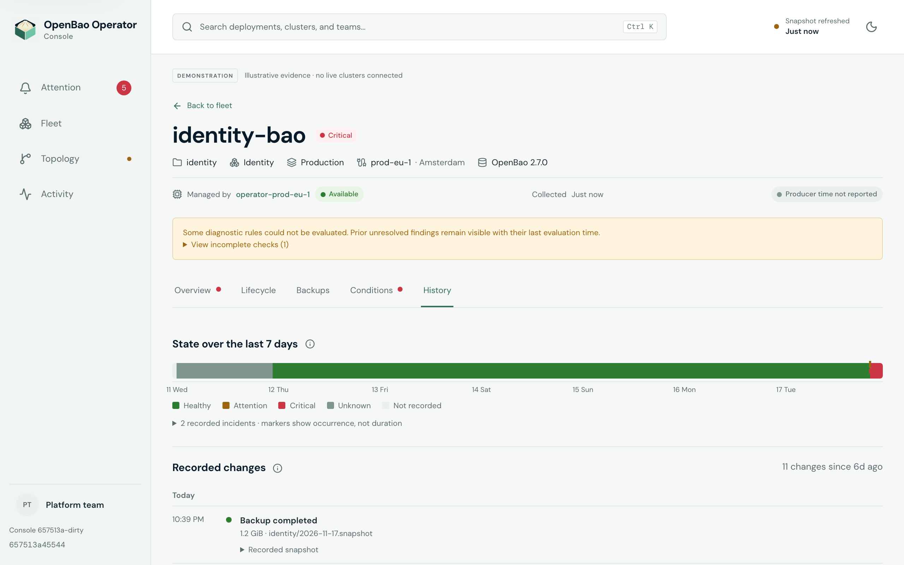
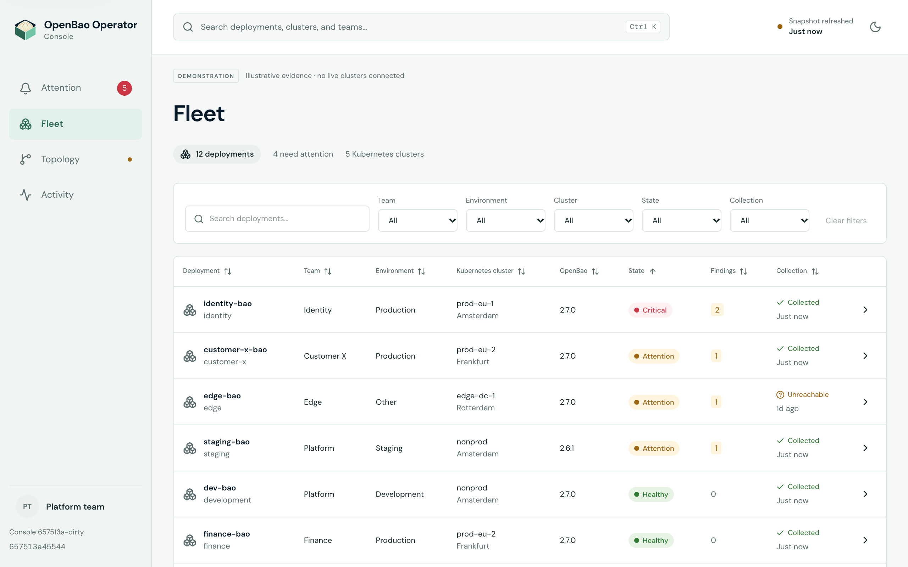
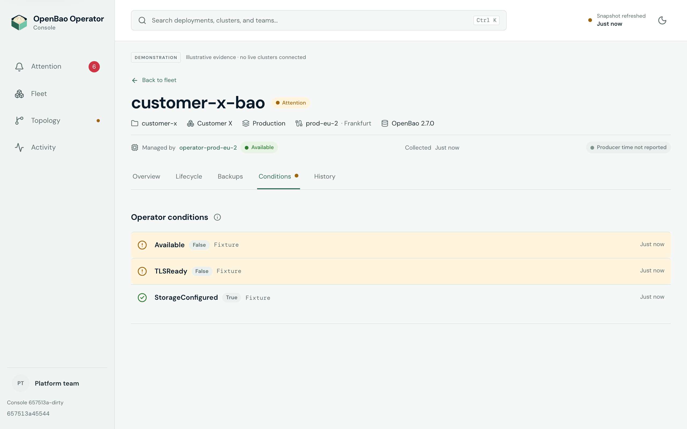
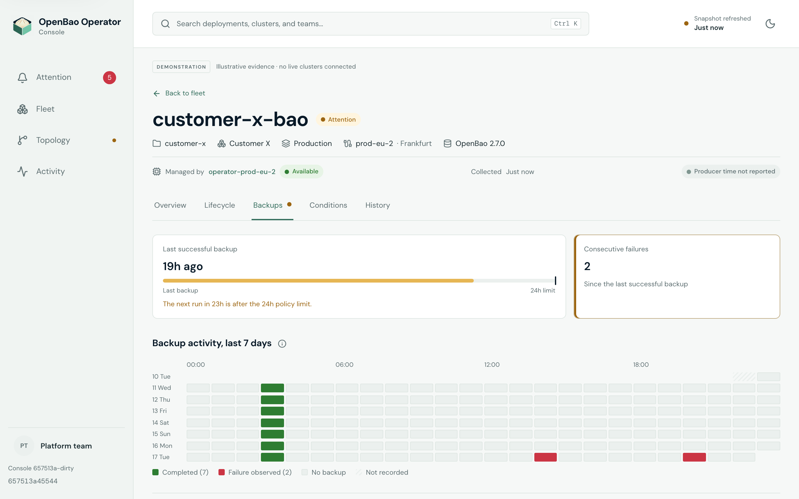
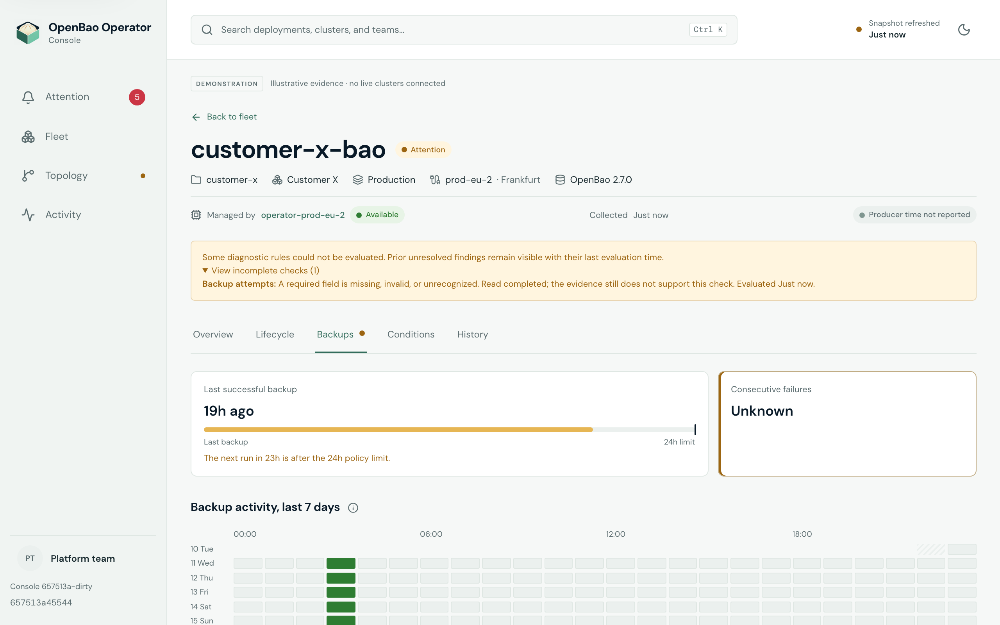
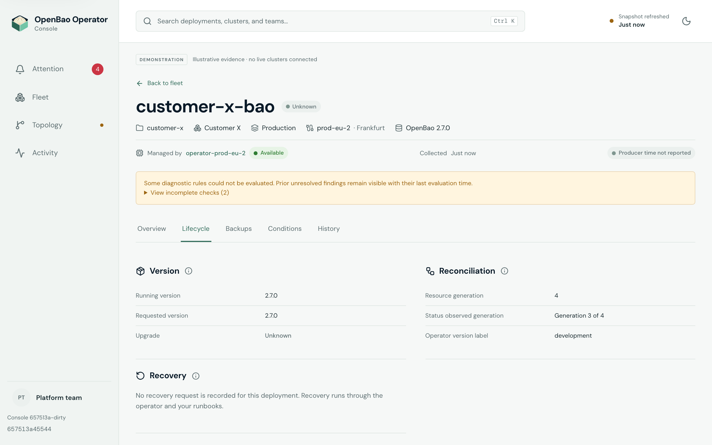

# Attention rules

The console uses the shared operator client to evaluate each collected OpenBao deployment against selected rules. A rule that matches creates a
finding with a severity. Findings appear in **Attention**, mark the matching tab on the deployment page, and highlight
the evidence rows that triggered them.

The overview tiles group findings by availability, backups, restore tests, and lifecycle. The History tab lists every
recorded change, including when each finding was raised or resolved. Its state graph loads all retained evidence in
the rolling seven-day window. Brief incidents have visible markers; expand the incident list to read their recorded
intervals. **Load older observations** adds records to the list without changing graph coverage.
The graph carries recorded state forward until its next change. It cannot distinguish time while the console was
stopped from unchanged state.

Rules use current evidence only. When collection fails, the console keeps the last known findings and adds a collection
finding instead of treating missing evidence as recovery.

## Deployment state

| State | Meaning |
| --- | --- |
| Critical | At least one critical finding. |
| Attention | At least one high finding and no critical finding. |
| Healthy | Ready replicas meet positive desired replicas, selected rules have sufficient evidence, and no finding applies. |
| Unknown | Replica counts are missing, desired replicas are zero, or analysis is incomplete, and no finding applies. |

The Fleet view sorts by state in that order: critical, attention, unknown, then healthy.

## Rules

| Finding | Severity | Category | Triggered when | Evidence shown on |
| --- | --- | --- | --- | --- |
| Replicas need attention | Critical when 0 ready, otherwise high | Service availability | Ready replicas are below desired replicas after the startup grace period. The operator omits a zero ready count; it counts as zero once the operator has observed the current generation | Overview: ready / desired replicas |
| Operator reports unavailable | High | Service availability | The operator reports `Available=False` with current resource and condition acknowledgement | Conditions tab: `Available` |
| Operator condition: *type* | High, or info for `EtcdEncryptionWarning` | Service availability | A recognized current condition reports an adverse state, such as `Degraded=True`, `TLSReady=False`, or `ReadServingAvailable=False` | Conditions tab: matching condition |
| OpenBao is sealed | Critical | Service availability | The operator reports `OpenBaoSealed=True` for the current resource generation | Conditions tab |
| Upgrade requires investigation | High | Operations | The operator records an upgrade failure | Lifecycle tab |
| Recovery requires investigation | High | Operations | A UID-confirmed snapshot restore reports failure, an unknown outcome, failed cleanup, or failed follow-through. An omitted phase remains unknown; it does not imply acceptance | Lifecycle tab |
| Backup failed | High | Backup protection | One or more consecutive backup attempts failed | Backups tab |
| No successful backup observed | High | Backup protection | Backups are configured but no successful completion is recorded | Backups tab |
| Backup is overdue | High | Backup protection | The last successful backup is older than the maximum backup age | Backups tab |
| Restore test needs attention | High | Backup protection | The latest restore test failed or is blocked | Backups tab |
| Collection is incomplete | High | Collection | The console cannot refresh this deployment's evidence | Overview: collection result |

Paused clusters do not raise replica or sealed findings. Condition acknowledgement must equal the positive resource generation. Missing, stale, and inconsistent
acknowledgement cannot establish a current finding. Resource acknowledgement and individual condition acknowledgement
remain separate.

Availability and recognized-condition rules run even when all voter replicas are ready. Read-replica conditions are
excluded when the specification has no read pool or reports zero desired replicas. If pool configuration is unknown,
the operator's `NoReadReplicasConfigured` reason excludes them. `EtcdEncryptionWarning=True` is informational because
the operator cannot inspect API-server encryption at rest; the advisory alone does not change deployment health.
Unknown or unacknowledged conditions keep selected analysis incomplete. Each condition finding has its own stable
identity, so simultaneous conditions retain separate first-seen times and history. Findings open the Conditions tab
and highlight the matching row.

## Policies

Administrators set two thresholds in **Settings → Policies**:

| Policy | Default | Effect |
| --- | --- | --- |
| Maximum backup age | 24 hours | A configured backup older than this raises **Backup is overdue**. |
| Startup grace | 10 minutes | Replica findings wait this long after a deployment is created. |

The Backups tab shows the age of the last successful backup against the maximum backup age, backup activity over the
last seven days, and the latest restore test. The age bar measures time against the policy limit, not the backup
schedule. Backup activity loads the complete window independently of the observation list. Each cell covers one local
clock hour and can contain several completions. The rolling window can span eight dates, with partial first and last
dates. Missing retained evidence remains **Not recorded**.

## Collection and freshness

The collector reads every enrolled cluster on its own 30-second schedule. A connection without a completed collection
for two minutes becomes stale. Stale and failed collections keep the last known deployments and findings, mark them as
uncertain, and add **Collection is incomplete**. This high-severity finding makes the deployment at least **Attention**,
so it is never shown as healthy while its collection is not current. Critical findings keep it **Critical**.

Successful inventory collection can still leave analysis incomplete, for example after a denied restore read or an
invalid producer value. The deployment page marks this state and retains prior unresolved findings with their last
evaluation time. Expand **View incomplete checks** to see each affected check, its bounded diagnostic reasons, read
outcome, and evaluation time. A denied read points to reader permissions; missing fields, stale evidence, unconfirmed
generations, and unverified identities remain separate causes. The console stores no provider messages in these gaps.
A failed collection retains the last evaluated reasons and their original times. Older retained observations can lack
details; the page says when those reasons are unavailable.

For an inspected operator contract, the adapter interprets an omitted backup failure count as zero
only when backup status records a success at or after the latest attempt. Other missing counters remain unknown.
The UI does not calculate failure deltas across unknown observations.

The Attention page also shows banners when a cluster cannot provide current evidence or an enrolled operator Deployment
is unavailable, progressing, or not observed. Deployments in an unreachable cluster cannot be discovered, so the console
cannot assess them.

## Resource and condition acknowledgement

The lifecycle view uses `status.observedGeneration` for resource acknowledgement. It never derives this value from the
largest condition generation. Older retained observations without this field show unknown acknowledgement. Each
condition acknowledges its own generation independently; one current condition does not make the others current.

Upgrade summaries require current collection and matching positive resource acknowledgement. If the `Upgrading`
condition is reported, its own acknowledgement must also be current and its status must be known. Stale failures and
conditions do not establish a current failed or active upgrade. **Versions match** means the requested and reported
versions agree; it does not prove that post-upgrade checks passed. Recorded failure details remain available.

The seal summary requires a condition for the current resource generation. Stale conditions show **Seal state not
current**. Failed collection shows **Seal state last known**. Replica counts without current resource acknowledgement
are labeled as reported counts.

## What findings do not prove

The console reports what the operator and Kubernetes record. It does not test OpenBao itself.

- Ready replicas are workload readiness, not a successful client transaction.
- The absence of findings means no rule matched current evidence. It is not a health guarantee.
- Backup completion age is not a measured recovery point objective (RPO). A past upload does not prove the backup is
  still readable.
- A restore-test pass covers a pinned snapshot restored into a disposable target in the same cluster. It does not test
  client logins, secret reads, or a cross-cluster recovery.
- Operator Deployment readiness does not prove successful reconciliation, and the version label does not verify the
  running binary.
- The console has no general controller heartbeat. Controller observation freshness is shown as unknown.
