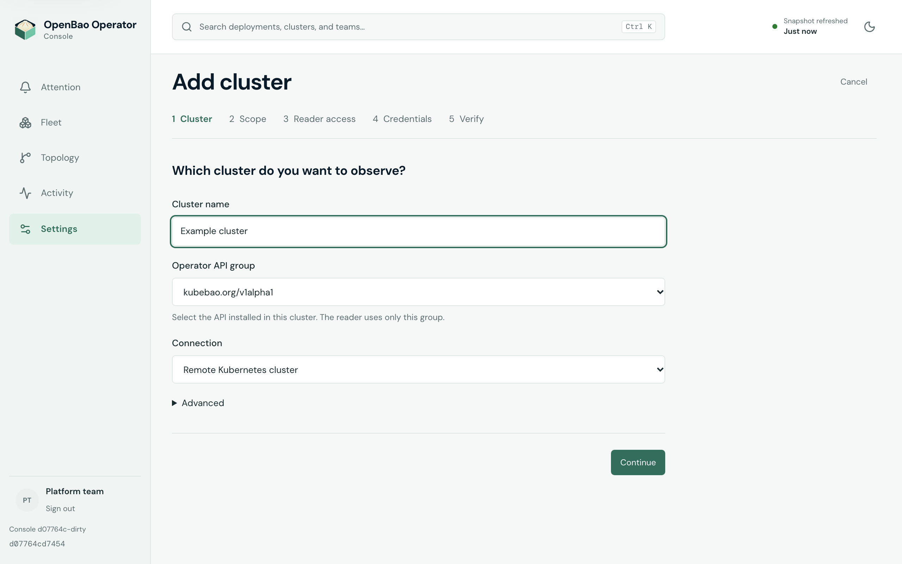
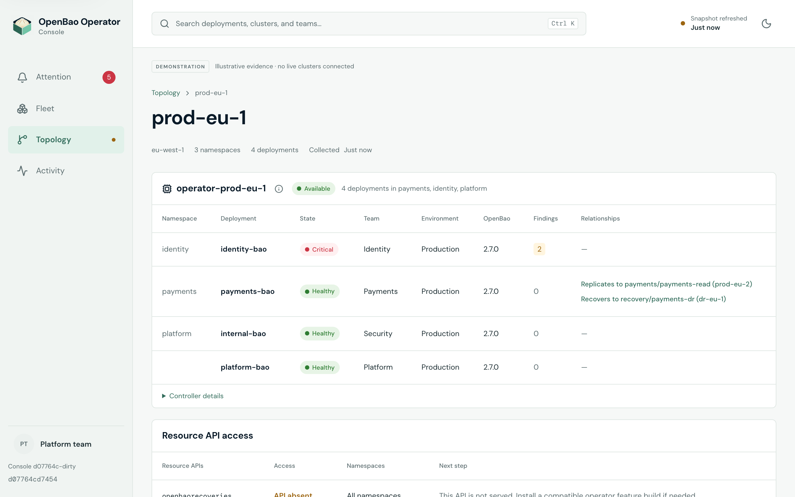

# Connect a Kubernetes cluster

A console administrator can add clusters in **Settings → Clusters → Add cluster**. The console stores the enrollment and
encrypted reader credentials in the configured database. Administrators apply reader grants and issue the initial credential. Remote
ServiceAccount tokens can then use [automatic renewal](credential-renewal.md).

## Add a cluster

This example uses fictional enrollment values. Select the API group before verifying reader access.

1. Enter a cluster name and select the **Operator API group** installed in that cluster: `kubebao.org` (the default for
   new enrollments) or legacy `openbao.org`. Select a remote cluster or the cluster that hosts the console. The console
   generates a stable identifier; use **Advanced** to set your own identifier before enrollment.
2. Enter each namespace to observe. If you want controller health, select **Observe the operator for these namespaces**.
   The fields start with the OpenBao Operator chart defaults for the release `openbao-operator`:
   `openbao-operator-system`, `openbao-operator-controller`, and `manager`. Change them to match your installation. For unattended remote collection, select **Renew
   ServiceAccount tokens automatically** and enter the reader's namespace and ServiceAccount. The console does not
   discover controller ownership.
3. Download the reader RBAC. Enter the target `kubectl` context and run the displayed commands in your terminal. Check
   the namespace before creating it or applying RBAC. For the hosting cluster, skip this step when the Helm values
   `readerScopes` and `operatorReaders` already grant the same access; verification checks it. Legacy `readerNamespaces`
   grants access to `openbao.org` only.
4. For a remote cluster, import a scoped reader kubeconfig or supply an embedded token or client certificate. For the
   hosting cluster, the console uses its mounted ServiceAccount token.
5. Select **Verify connection**. Review namespace permissions, optional API checks, and the deployment preview. Select
   **Connect cluster** to start collection, or **Save paused** to retain the enrollment without starting collection.

After connecting, the console polls until the first collection completes and lists the observed deployments. **View
deployments** opens the fleet filtered to the new cluster. In **Topology**, select the cluster to see its operators,
deployments, relationships, and API access.

Reader manifests grant namespace-scoped `list` access to `OpenBaoCluster` and `OpenBaoRestore` in the selected API group.
Named operator observation adds `get` access to the declared Deployment. Automatic renewal adds `create` on
`serviceaccounts/token`, so decide on renewal in the Scope step before the reader manifests are generated. The grant is
restricted to the declared ServiceAccount in its namespace. The manifests grant no Secret, Pod, or cluster-wide
permissions.

The reader does not discover or fall back to another API group. Existing enrollments that omit the group retain
`openbao.org`. An enrolled identifier stays bound to its group after removal and restart. For an API-group migration,
add a connection with a new identifier and matching reader grants. The console keeps the original history and routes
separate; it does not infer that migrated objects are the same deployment.

Generated Role and RoleBinding names include a stable suffix for each connection. Enrollments that share a physical
cluster and namespaces do not replace each other's rules or the chart's reader roles. The ServiceAccount name stays
unchanged. Kubernetes administrators own these grants: after changing scope or removing a connection, remove its
obsolete generated Roles and RoleBindings. The console stops collecting removed scope but does not revoke Kubernetes
permissions.

The generated remote-reader commands request a token with a 24-hour lifetime and write a new private kubeconfig. The
Kubernetes API can shorten that lifetime. The commands refuse to overwrite an existing `console-reader.kubeconfig`; move
that file before generating a replacement. Import only the scoped reader file, not an administrator kubeconfig.

The reader kubeconfig must embed its credentials and CA. Authentication plugins, file references, impersonation,
proxies, and disabled TLS verification are rejected. The configured API address must be reachable from the console; an
address that works only from your workstation does not establish console connectivity.

## Interpret verification results

Verification reads the declared namespaces and projects approved fields into a preview. It does not save observations or
change enrollment. A successful check means the reader can collect workloads; it does not mean the OpenBao deployments
are healthy.

| Result | Action |
| --- | --- |
| API unreachable | Check the API address and network access from the console. |
| TLS verification failed | Check the CA, hostname, and certificate validity. |
| Credentials rejected | Replace the credential and verify again. |
| Workload access denied | Apply the generated reader RBAC in each enrolled namespace. |
| OpenBaoCluster API unavailable | Check that the operator CRDs are installed in the selected cluster. |
| Optional API unavailable or denied | Basic workload collection can continue. The affected restore or recovery evidence remains unknown. |
| No deployments found | Connect the cluster if the namespaces are correct. New deployments appear during collection. |

An authentication failure or transport failure on an optional API still fails the connection check. Forbidden or absent
optional APIs remain separate capability warnings. Controller checks report the declared Deployment independently of
workload access.

After saving an enabled cluster, the console waits for its first collection. Review cluster settings if collection
fails. Configure teams, environments, additional operators, and access rules after enrollment.

## Replace credentials

In **Settings → Clusters**, select **Edit** or **Reconnect** and provide a complete replacement credential. Select
**Test connection**, then save. Leaving credential fields empty preserves the latest stored reader, including tokens
issued while the editor was open. Client certificates and remote tokens without automatic renewal require manual
replacement.

The connection check shows a client certificate's expiry when available. A token expiry is an unverified declaration
from its payload; it does not prove authenticity or future acceptance. Opaque tokens have unknown expiry. The hosting
cluster manages the console's mounted ServiceAccount token.

Coordinate credential replacement with the cluster owner. Automatic renewal requires the reader's named TokenRequest
grant and a still-valid token. Once that token expires, issue and upload a new reader credential.

## Concurrent changes

Cluster enrollment uses the configuration revision loaded when onboarding starts. If another administrator changes
settings, reload settings from the conflict message, review the retained cluster details, and save again. Reloading does
not clear the onboarding form. A cluster identifier that another administrator has enrolled must be changed before
saving.
